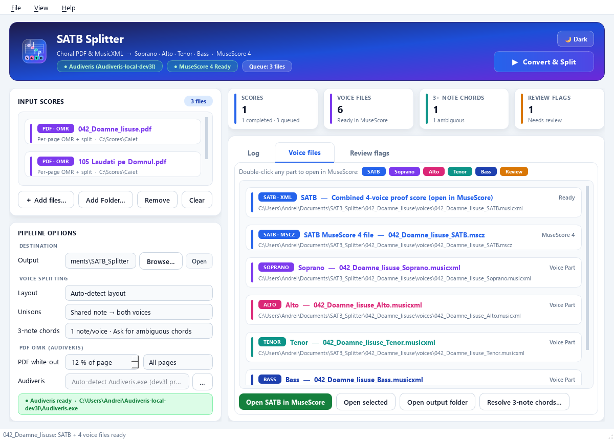
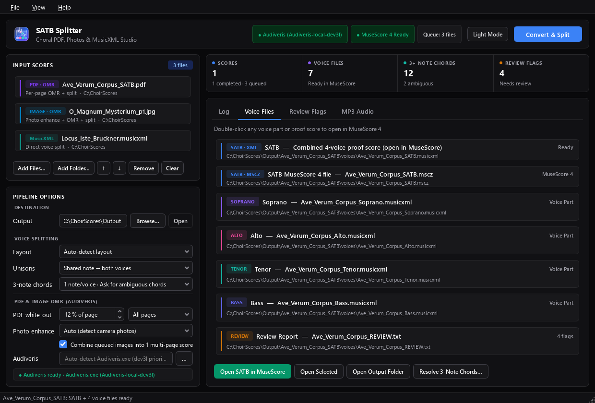

# SATB Splitter

Desktop application and CLI toolkit that splits choral & piano-vocal **PDFs**, **sheet music photos/images**, and **MusicXML** scores into separate **Soprano, Alto, Tenor, and Bass** parts — plus a combined SATB score and optional MuseScore 4 `.mscz` export.

<p align="center">
  
  
</p>

---

## Quick Start — Travelling / Portable Windows Version (No Compiling Needed)

If you just want to run **SATB Splitter** on Windows without installing Python, Java, or Audiveris:

1. Go to the [**Releases**](../../releases) page and download **`SATB-Splitter-v0.4.0-Windows-Portable.zip`**.
2. Extract the ZIP folder anywhere (Desktop, Documents, or a USB drive).
3. Double-click **`SATB Splitter.exe`**.

Everything needed for offline PDF Optical Music Recognition (bundled **Audiveris** + Tesseract `eng`/`ron` OCR data) and MusicXML voice splitting is already included inside the folder.

> **Optional MuseScore 4 Integration:** If [MuseScore 4](https://musescore.org/) is installed on your PC, SATB Splitter automatically converts the combined SATB MusicXML into `*_SATB.mscz` and lets you open parts directly in MuseScore.

---

## How to Use (Step-by-Step Guide)

1. **Add scores**
   - Drag and drop `.pdf`, sheet music images/photos (`.png`, `.jpg`, `.jpeg`, `.webp`, `.bmp`, `.tif`, `.tiff`), or `.musicxml` / `.mxl` / `.xml` files (or entire folders) onto the drop zone — or onto **`SATB Splitter.exe`** directly.
   - Or click **Add Files…** / **Add Folder…** in the **Input Scores** panel, and use **↑ / ↓** to reorder multi-page sheet photos.
2. **Choose Pipeline Options**
   - **Output**: Pick where the generated voice files should be saved.
   - **Layout**: Leave on **Auto-detect layout** (automatically detects 2-staff `SA / TB`, 3-staff `SA / T / B`, 4-staff open score, and single-staff scores), or choose a specific layout template.
   - **Unisons**: Choose how shared unison notes on a two-voice staff are handled (default: **Shared note → both voices**).
   - **3-note chords**: Choose how 3+ note simultaneous chords on a two-voice staff are resolved (default: **1 note/voice · Auto (recommended)**, or **Ask for ambiguous chords** to review interactively).
   - **PDF white-out**: Top header band percentage (default `12%` on **All pages**) masked before OMR so ornate title/scripture headers don't trip up Audiveris metronome detection. Failed pages automatically retry with wider white-out (`22%`, `30%`).
   - **Photo enhance & Combine**: **Auto** automatically detects camera photos and scanned/mobile-scanner PDFs, respects smartphone EXIF orientation, performs trapezoid perspective rectification, removes dark table borders, flattens uneven lighting/shadows, stretches contrast cleanly, deskews tilted pages, and normalizes resolution to ~300 DPI. Check **Combine queued images into 1 multi-page score** to merge ordered sheet photos into a single score.
   - **Audiveris**: Automatically detected (uses the bundled `Audiveris\Audiveris.exe` in portable builds).
3. **Convert & Split**
   - Click **Convert & Split**. Progress and per-page OMR status appear in the **Log** tab.
4. **Inspect Output Files**
   - Open the **Voice Files** tab to see all generated files in `<output>\voices\`:
     - `<name>_Soprano.musicxml`
     - `<name>_Alto.musicxml`
     - `<name>_Tenor.musicxml`
     - `<name>_Bass.musicxml`
     - `<name>_SATB.musicxml` (all 4 voices in one score)
     - `<name>_SATB.mscz` (written automatically if MuseScore 4 is installed; never overwrites `.mscz` files you edited manually)
     - `<name>_REVIEW.txt` (summary + per-bar review flags table)
5. **Resolve 3-Note Chords & Review Flags**
   - Click **Resolve 3-Note Chords…** to inspect or override how ambiguous 3-note chords were assigned between Soprano/Alto or Tenor/Bass, then re-export immediately.
   - Check the **Review Flags** tab (with live keyword filtering) for any OMR warnings, clipped notes, meter mismatches, voice crossings, or multi-bar rest checks.
6. **Export Grand Piano MP3 Practice Tracks (MP3 Audio Tab)**
   - Open the **MP3 Audio** tab (requires MuseScore 4) to render **Soprano**, **Alto**, **Tenor**, **Bass**, or **SATB (Full)** parts as `*_Piano.mp3` rehearsal tracks using **Acoustic Grand Piano** (MIDI program 1), with selectable bitrate (`128` / `192` / `320 kbps`) and optional tempo override (`BPM`).
   - Use **Load Voices…** anytime to render existing `.musicxml` / `.mxl` / `.xml` voice files without re-running OMR.
7. **Open in MuseScore 4**
   - Click **Open SATB in MuseScore** or double-click any individual part in **Voice Files** to open it in MuseScore 4 for playback, audio export, or final engraving tweaks.

---

## Features & Splitting Rules

- **Strictly monophonic output parts**: Each Soprano, Alto, Tenor, and Bass file is rebuilt bar-by-bar as a clean single voice with consistent bar counts and gap-filling rests.
- **Stem-aware voice separation**: MusicXML voice numbers from OMR are often inconsistent; SATB Splitter uses stem direction, voice grouping, and pitch order to assign upper/lower lines accurately.
- **Per-page PDF & Photo OMR**: Splits multi-page PDFs into individual pages before running Audiveris, isolating problematic pages and retrying with adaptive header white-out so one difficult page never breaks an entire booklet. Sheet music images, smartphone photos (`.png`, `.jpg`, `.jpeg`, `.webp`, `.bmp`, `.tif`, `.tiff`), and scanned/mobile-scanner PDFs get automatic EXIF rotation, trapezoid perspective rectification, dark table-border removal, uneven-shadow flattening, deskewing, and automatic 300-DPI normalization.
- **Layout & marker intelligence**: Handles mixed systems (e.g., `unison` / `tutti`, `S.A.`, `S.A.T.`, `femei` / `women`, `bărbați` / `men`, named solos like `solo tenor`), solo/trio staves above the choir, pickups, repeats, volta endings, fermatas, tempo/metronome marks, and multi-bar rests.
- **Studio Light & Dark Themes**: Toggle between Studio Light and Studio Dark anytime from the top bar.

---

## CLI Reference

### Split MusicXML directly (`satb-split`)

```bash
# Auto-detect layout (default: 2-staff SA/TB, 3-staff SA/T/B, 4-staff open)
satb-split path/to/score.musicxml -o outdir

# Force a specific template
satb-split score.musicxml -o outdir --template two_staff_satb
satb-split score.musicxml -o outdir --template three_staff_satb
satb-split score.musicxml -o outdir --template four_staff_open

# Unison & divisi policies
satb-split score.musicxml -o outdir --unison duplicate_both --divisi monophonic_auto
```

### Per-page PDF & Photo OMR + Split (`satb-omr`)

```bash
# Run per-page Audiveris OMR only
satb-omr path/to/score.pdf -o workdir

# Run OMR, split every page, and merge into one set of SATB + S/A/T/B files
satb-omr score.pdf -o workdir --split

# Run OMR on multi-page camera photos (auto EXIF, shadow flatten, deskew) and split
satb-omr p1.jpg p2.jpg -o workdir --split

# Customize top-band white-out, photo enhancement, and retries
satb-omr score.pdf -o workdir --whiteout 0.14 --whiteout-mode all --retry-whiteout 0.22,0.30 --split
```

---

## Developer Install

Requires **Python 3.11+**.

```bash
git clone https://github.com/KnightL1ght/satb-splitter.git
cd satb-splitter

python -m venv .venv
.venv\Scripts\activate        # Windows
# source .venv/bin/activate   # macOS / Linux

pip install -e ".[dev,gui,omr]"
```

Run the desktop Studio UI or test suite:

```bash
satb-app                      # Launch Desktop UI
pytest -q                     # Run test suite
```

### Building the Windows Portable Release ZIP

If you have PyInstaller installed in `.venv` and a local Audiveris distribution (`C:\Users\<user>\Audiveris-local-dev3l` or custom path):

```powershell
.\.venv\Scripts\pip install pyinstaller
.\scripts\build_portable_zip.ps1
```

This builds `release_staging\SATB-Splitter-v0.4.0-Windows-Portable.zip` along with the Audiveris patch source archive `release_staging\audiveris-dev3l-source-patches.zip`.

---

## Licenses & Credits

- **SATB Splitter** (`src/`, `tests/`, `scripts/`, `templates/`, `assets/`) is licensed under the [**MIT License**](LICENSE).
- **Portable Windows Releases** optionally bundle a modified build of [**Audiveris**](https://github.com/Audiveris/audiveris) (for offline OMR), which is licensed under the **GNU Affero General Public License v3.0 (AGPL-3.0)**.
  - The corresponding source modifications (`audiveris-dev3l-source-patches.zip`) and license notices (`LICENSE_AGPL3.txt`, `MODIFICATIONS.md`) are distributed alongside each portable release on the [**Releases**](../../releases) page.
- Built with [music21](https://web.mit.edu/music21/), [PySide6](https://doc.qt.io/qtforpython-6/), [PyMuPDF](https://pymupdf.readthedocs.io/), and [Audiveris](https://audiveris.org/).
